<div align="center">

# 📉 Telco Customer Churn Prediction

**An end-to-end, leak-free machine learning pipeline that predicts which telecom customers are about to leave.**


[Overview](#-overview) · [Architecture](#-architecture) · [Dataset](#-dataset--data-dictionary) · [Project Structure](#-project-structure) · [Quick Start](#-quick-start) · [Results](#-results) · [Contact](#-contact)

</div>

---

## 📑 Table of Contents

- [Overview](#-overview)
- [Architecture](#-architecture)
- [Dataset & Data Dictionary](#-dataset--data-dictionary)
- [Data Cleaning](#-data-cleaning)
- [Feature Engineering](#-feature-engineering)
- [Modeling & Evaluation](#-modeling--evaluation)
- [Results](#-results)
- [Project Structure](#-project-structure)
- [Quick Start](#-quick-start)
- [Using the Saved Model](#-using-the-saved-model)
- [Design Decisions](#-design-decisions)
- [Contact](#-contact)

---

## 🎯 Overview

Acquiring a new customer costs far more than keeping an existing one, so telecom companies want to know **who is likely to churn before they leave**. This project builds a classifier on the public IBM Telco dataset and treats it the way a production project would:

- Cleaning decisions are **verified against the data**, not assumed.
- All preprocessing lives inside a scikit-learn `Pipeline`, so **nothing leaks** from the test set.
- Models are compared with **stratified 5-fold cross-validation** on metrics that suit an imbalanced problem (ROC-AUC, PR-AUC, recall, F1), not accuracy alone.
- The decision threshold is **tuned on out-of-fold predictions**, and the test set is used exactly once.
- The final model is **saved with its threshold** and accepts raw customer rows.

> **Why not just report accuracy?** About 73.5% of customers do not churn, so a model that always predicts "stays" already scores ~73.5% accuracy while catching zero churners.

---

## 🏗 Architecture

```mermaid
flowchart LR
    A[("Raw CSV<br/>7,043 customers")] --> B["Cleaning<br/>fix TotalCharges, merge redundant labels"]
    B --> C["Stratified split<br/>80% train / 20% test"]

    subgraph P["scikit-learn Pipeline (fit on train only)"]
        direction LR
        D["Feature engineering<br/>n_services, avg spend, price delta"] --> E["ColumnTransformer<br/>StandardScaler + OneHotEncoder"] --> F["Classifier"]
    end

    C -->|train| P
    P --> G["5-fold CV model comparison<br/>LogReg / Tree / RF / HistGB"]
    G --> H["GridSearchCV<br/>hyperparameter tuning"]
    H --> I["Threshold tuning<br/>out-of-fold predictions"]
    C -->|test, used once| J["Final evaluation<br/>ROC, PR, confusion matrix"]
    I --> J
    J --> K[("churn_model.joblib<br/>model + threshold")]
```



---

## 📊 Dataset & Data Dictionary

**Source:** [IBM Telco Customer Churn](https://github.com/IBM/telco-customer-churn-on-icp4d/blob/master/data/Telco-Customer-Churn.csv) · 7,043 customers · 21 columns · 26.5% churn rate.

### Original columns

| Column | Type | Description |
|---|---|---|
| `customerID` | string | Unique customer identifier (dropped before modeling) |
| `gender` | categorical | Male / Female |
| `SeniorCitizen` | binary | 1 if the customer is a senior citizen |
| `Partner` | categorical | Has a partner (Yes / No) |
| `Dependents` | categorical | Has dependents (Yes / No) |
| `tenure` | integer | Months the customer has stayed with the company |
| `PhoneService` | categorical | Has phone service (Yes / No) |
| `MultipleLines` | categorical | Has multiple phone lines |
| `InternetService` | categorical | DSL / Fiber optic / No |
| `OnlineSecurity` | categorical | Has online security add-on |
| `OnlineBackup` | categorical | Has online backup add-on |
| `DeviceProtection` | categorical | Has device protection add-on |
| `TechSupport` | categorical | Has tech support add-on |
| `StreamingTV` | categorical | Streams TV |
| `StreamingMovies` | categorical | Streams movies |
| `Contract` | categorical | Month-to-month / One year / Two year |
| `PaperlessBilling` | categorical | Uses paperless billing (Yes / No) |
| `PaymentMethod` | categorical | Electronic check / Mailed check / Bank transfer / Credit card |
| `MonthlyCharges` | float | Current monthly bill |
| `TotalCharges` | float | Total amount billed over the customer's lifetime |
| `Churn` | **target** | 1 if the customer left, 0 otherwise |

### Engineered features

| Feature | Formula | Intuition |
|---|---|---|
| `n_services` | count of "Yes" across the 6 add-on services | Customers with more services are more locked in |
| `avg_monthly_spend` | `TotalCharges / tenure` | Historical average bill |
| `charge_delta` | `MonthlyCharges - avg_monthly_spend` | Positive value signals a recent price increase |
| `has_family` | `Partner == Yes or Dependents == Yes` | Household stability |

---

## 🧹 Data Cleaning

| Issue | Finding | Decision |
|---|---|---|
| `TotalCharges` stored as text | 11 rows contain a blank string | Verified that **all 11 have `tenure == 0`** (not yet billed), so they are set to `0.0` instead of being dropped |
| Redundant categories | "No internet service" / "No phone service" duplicate information already in `InternetService` / `PhoneService` | Merged into "No" |
| Identifier column | `customerID` carries no signal | Dropped |
| Target encoding | `Churn` is Yes / No | Mapped to 1 / 0 |

```python
df["TotalCharges"] = pd.to_numeric(df["TotalCharges"].str.strip(), errors="coerce")
assert df.loc[df["TotalCharges"].isna(), "tenure"].eq(0).all()   # prove the assumption
df["TotalCharges"] = df["TotalCharges"].fillna(0.0)
```

---

## 🛠 Feature Engineering

Features are row-level only (no target information, no cross-row statistics) and are wrapped in a `FunctionTransformer` inside the pipeline.

```python
def add_features(d):
    d = d.copy()
    d["n_services"] = (d[SERVICES] == "Yes").sum(axis=1)
    d["avg_monthly_spend"] = np.where(d["tenure"] > 0,
                                      d["TotalCharges"] / d["tenure"].clip(lower=1),
                                      d["MonthlyCharges"])
    d["charge_delta"] = d["MonthlyCharges"] - d["avg_monthly_spend"]
    d["has_family"] = ((d["Partner"] == "Yes") | (d["Dependents"] == "Yes")).astype(int)
    return d
```

Preprocessing: `StandardScaler` for numeric columns, `OneHotEncoder(drop="if_binary", handle_unknown="ignore")` for categorical columns.

---

## 🤖 Modeling & Evaluation

Five candidates are compared with stratified 5-fold cross-validation on the training set only:

```python
cv = StratifiedKFold(n_splits=5, shuffle=True, random_state=42)
scoring = {"accuracy": "accuracy", "recall": "recall", "f1": "f1",
           "roc_auc": "roc_auc", "pr_auc": "average_precision"}
```

| Model | Accuracy | Recall | F1 | ROC-AUC | PR-AUC |
|---|---|---|---|---|---|
| Baseline (majority class) | 0.735 | 0.000 | 0.000 | 0.500 | 0.265 |
| Logistic Regression | 0.749 | 0.800 | 0.629 | 0.845 | 0.657 |
| Decision Tree | 0.732 | 0.787 | 0.609 | 0.827 | 0.614 |
| Random Forest | 0.779 | 0.718 | 0.633 | 0.844 | 0.656 |
| Hist. Gradient Boosting | 0.749 | 0.800 | 0.629 | 0.846 | 0.660 |

*Cross-validation means on the training set.* The two best models were tuned with `GridSearchCV` (ROC-AUC); **Histogram Gradient Boosting** won (CV ROC-AUC 0.849).

---

## 🏆 Results

Final scores on the **held-out test set** (1,409 customers, used once):

| Metric | Threshold 0.50 | Tuned threshold (0.56) |
|---|---|---|
| Accuracy | 0.741 | 0.757 |
| Precision | 0.508 | 0.529 |
| **Recall** | 0.805 | **0.775** |
| F1 | 0.623 | 0.629 |
| **ROC-AUC** | 0.843 | **0.843** |
| PR-AUC | 0.657 | 0.657 |

The model identifies roughly **3 out of 4 churners**. The notebook also reports a confusion matrix, ROC curve, precision-recall curve and permutation feature importance.

> Results can shift slightly with library versions. The seed (`42`) is fixed for reproducibility.

---

## 📁 Project Structure

| Path | Type | Description |
|---|---|---|
| `customer_churn_prediction_corrected.ipynb` | Notebook | Full pipeline: cleaning, features, modeling, evaluation, export |
| `WA_Fn-UseC_-Telco-Customer-Churn.csv` | Data | Raw IBM Telco dataset (place it next to the notebook) |
| `churn_model.joblib` | Artifact | Generated by the notebook: trained pipeline + decision threshold |
| `README.md` | Docs | This file |

---

## 🚀 Quick Start

```bash
# 1. Clone the repository
git clone https://github.com/<your-username>/<your-repo>.git
cd <your-repo>

# 2. Create an environment and install dependencies
python -m venv .venv
source .venv/bin/activate        # Windows: .venv\Scripts\activate
pip install pandas numpy scikit-learn matplotlib joblib jupyter

# 3. Run the notebook
jupyter notebook customer_churn_prediction_corrected.ipynb
```

> Requires **scikit-learn 1.5+** (`HistGradientBoostingClassifier` with `class_weight`).

---

## 🔮 Using the Saved Model

The saved pipeline contains the feature engineering and encoding, so it accepts **raw customer rows**:

```python
import joblib
import pandas as pd

artifact = joblib.load("churn_model.joblib")
model, threshold = artifact["model"], artifact["threshold"]

customer = pd.DataFrame([{
    "gender": "Female", "SeniorCitizen": 0, "Partner": "Yes", "Dependents": "No",
    "tenure": 3, "PhoneService": "Yes", "MultipleLines": "No",
    "InternetService": "Fiber optic", "OnlineSecurity": "No", "OnlineBackup": "No",
    "DeviceProtection": "No", "TechSupport": "No", "StreamingTV": "Yes",
    "StreamingMovies": "Yes", "Contract": "Month-to-month", "PaperlessBilling": "Yes",
    "PaymentMethod": "Electronic check", "MonthlyCharges": 95.5, "TotalCharges": 280.0,
}])

p = model.predict_proba(customer)[0, 1]
print(f"Churn probability: {p:.1%} -> {'CHURN RISK' if p >= threshold else 'likely to stay'}")
```

---

## 🧭 Design Decisions

- **Stratified split + fixed seed:** the 26.5% churn rate is preserved in train and test, and results are reproducible.
- **Pipeline over manual preprocessing:** scaling and encoding are fitted on training folds only, which prevents leakage.
- **One-hot instead of label encoding:** nominal categories such as `PaymentMethod` have no natural order.
- **Class weighting + tuned threshold:** trades a little accuracy for much better recall, which is what a retention team needs.
- **Business tuning:** the threshold maximizes F1 here. In production, replace it with the real cost of a missed churner versus the cost of a retention offer.

---

## 📬 Contact

<div align="center">

**Hamza**

[](https://www.linkedin.com/in/hamza-ben-allou-48ab31236)

*Feedback and suggestions are welcome. Feel free to open an issue or reach out on LinkedIn.*

</div>
